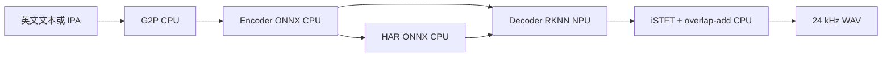

# Kokoro-82M on RK3588

在瑞芯微 RK3588 上跑 [hexgrad/Kokoro-82M](https://huggingface.co/hexgrad/Kokoro-82M) 英文 TTS。

**Encoder / HAR → ONNX Runtime（CPU）** · **Decoder → RKNN FP16（NPU）** · **iSTFT → numpy（CPU）**

板端不依赖 PyTorch。转换只能在 **x86_64 PC** 上做；本仓库只负责板端推理和评测。

[](https://www.python.org/)
[](https://www.rock-chips.com/)
[](https://github.com/airockchip/rknn-toolkit2)
[](https://huggingface.co/hexgrad/Kokoro-82M)

相对 CosyVoice3 那种 LLM + Flow 全图，Kokoro 只有约 82M，Decoder 才上 NPU，RSS 大约 **470–490 MB**。

> **ONNX / RKNN 权重不在本仓库。** 单文件超过 GitHub 100 MB。请在 x86 PC 上用 [kokoro-server](https://github.com/marty1885/kokoro-server) 的 `build.py` 转换，再拷到板端 `onnx/`。

## 实测

锁频、warmup、排除模型加载后，`benchmark.py` 的合理量级：

| 指标 | 量级 | 口径 |
|------|------|------|
| RTF | **0.41–0.50** | 推理墙钟 / 音频时长（&lt; 1 快于实时） |
| TTFT | **430–500 ms** | 第一窗 Decoder + iSTFT 完成 |
| NPU | **约 60% / 22% / 22%** | Core0 / 1 / 2 峰值 |
| 内存 | **470–490 MB** | 进程 RSS |
| 显存 | **约 124 MB** | 无 `rknpu/mm` 时按模型文件大小兜底 |

默认 IPA 句约 2.52 s 音频，`--cores 0_1_2`。

`infer.py` 末尾的 `RTF …×` 是 **音频时长 / 推理墙钟**（加速倍数）。`benchmark.py` 与 MeloTTS / Whisper 仓库统一为 **推理墙钟 / 音频时长**。不要把两种数字直接对比。截图里的 RTF 0.139 属于深度优化 / C++ / 流式分桶，不是本仓库 Python 开箱值。

## 管线



```text
英文文本 或 IPA
  → [CPU]  G2P（仅 --text；misaki[en]）→ 音素 id
  → [CPU]  Encoder ONNX：input_ids + 音色 ref_s + speed
             → asr [1,512,T]、F0/N、style s、pred_dur
  → 按 T_FIX=50 切窗（两侧各 2 帧上下文）
  → [CPU]  HAR Generator ONNX：F0 → 谐波特征
  → [NPU]  Decoder RKNN：asr + F0 + N + s + har → spec / phase
  → [CPU]  iSTFT（Hann，n_fft=20, hop=5）→ 24 kHz PCM
  → [CPU]  窗间 overlap-add（depop）拼成整段 WAV
```

| 模块 | 运行位置 | 说明 |
|------|----------|------|
| G2P | CPU | `--text` 用 misaki；`--phonemes` 跳过。必须在 `rknnlite` 之前完成 |
| Encoder | CPU，ONNX | `onnx/kokoro_encoder.onnx`。BERT + 时长/韵律 |
| HAR | CPU，ONNX | `onnx/har_generator.onnx`。含 Atan 等 NPU 不支持的算子，不要上 NPU |
| Decoder | NPU，RKNN FP16 | `onnx/kokoro_decoder.rknn`。ISTFTNet 主体，静态窗 `T_FIX` |
| iSTFT / 拼窗 | CPU，numpy | 与 `CustomSTFT.inverse` 对齐；窗缝 crossfade 480 点 |

Decoder 是静态图，warmup / 每窗输入必须是：

| 输入 | 形状（默认 `T_FIX=50`） |
|------|-------------------------|
| `asr` | `[1, 512, T_FIX]` |
| `F0` / `N` | `[1, 2*T_FIX]` |
| `s` | `[1, 128]`（Encoder 给出的 style，不是 256-d 音色包） |
| `har` | `[1, 22, 2*T_FIX*300//5 + 1]` → `[1, 22, 6001]` |

长句按 `STEP = T_FIX - 2*DEPOP_CTX`（默认 46 帧）滑窗，每窗两侧各 `DEPOP_CTX=2` 帧真实上下文，缝上 `DEPOP_OVL=480` 点线性 crossfade，避免 FP16 窗边界台阶。`--t-fix` 必须与 `build.py` 编译时一致。

每帧对应 **600** 个 24 kHz 采样（`SAMPLES_PER_FR`）。含上下文的 50 帧窗约 1.25 s；每窗实际发出约 1.15 s。EOS 对应的 `pred_dur` 尾帧不发声，只当上下文。Encoder 的音色包 `ref_s` 是 `[1, 256]`（`voices_npy/*.npy`，可按音素长度从 `(510, 1, 256)` 里取一行）。

## 目录

```text
kokoro_rknn/
├── infer.py                 # 板端推理：G2P → Encoder → HAR → Decoder → WAV
├── benchmark.py             # 模型只加载一次，多次合成取平均
├── rk3588_metrics.py        # RTF / TTFT / CPU / 内存 / NPU / 显存
├── Kokoro-82M/config.json   # 词表（运行时只需要 vocab）
├── onnx/                    # 转换产物，不进 git
│   ├── kokoro_encoder.onnx
│   ├── har_generator.onnx
│   └── kokoro_decoder.rknn
├── voices_npy/              # 音色 .npy（如 af_heart.npy）
├── wavs/                    # 输出
└── logs/                    # 评测摘要
```

本仓库没有 `build.py`。PC 上用 kokoro-server 转模，再把 `onnx/`、`voices_npy/`、`config.json` 拷到板端项目目录。

## 环境

| 组件 | 版本 | 放在哪 |
|------|------|--------|
| RKNPU driver | v0.9.8+ | 板端 |
| `librknnrt.so` | 与 rknn-toolkit2 **2.3.2** 同主版本 | 板端 `/usr/lib` |
| `rknn-toolkit-lite2` | 2.3.2，Python 3.10 aarch64 | 仅板端 |
| `rknn-toolkit2` | 2.3.2 | 仅 x86 PC |
| onnxruntime | CPU EP | 板端跑 Encoder / HAR |
| Python | 3.10 | PC 与板端分开环境 |
| PyTorch | 仅 PC 转模 | 板端不要装（`--text` 的 misaki 可能间接拉到 torch，见下文） |

板端确认驱动和库：

```bash
ls -la /usr/lib/librknnrt.so
dmesg | grep -i rknpu | tail
sudo cat /sys/kernel/debug/rknpu/version
sudo cat /sys/kernel/debug/rknpu/load
```

没有 `rknpu` 设备节点时换厂商官方镜像。`load` 始终 0% 说明 Decoder 没上 NPU。

## 1. PC：转 ONNX / RKNN

在 **x86_64 Linux / WSL2**（建议 16 GB+ 内存）。`rknn-toolkit2` 没有 aarch64 wheel。

```bash
conda create -n kokoro-build python=3.10 -y
conda activate kokoro-build
pip install torch numpy onnx onnxruntime
pip install rknn-toolkit2==2.3.2

git clone --recursive https://github.com/marty1885/kokoro-server.git
cd kokoro-server
git submodule update --init --recursive

pip install huggingface_hub
huggingface-cli download hexgrad/Kokoro-82M --local-dir Kokoro-82M

python3 build.py
# python3 build.py --t-fix 50      # 默认，须与板端 infer.py --t-fix 一致
# python3 build.py --t-fix 32      # 更短窗，TTFT 更低，长句窗数更多
# python3 build.py --skip-rknn     # 只导出 ONNX
```

`build.py` 会：导出 Encoder / HAR ONNX；做 InstanceNorm、Sin、Pow、ConvTranspose 等图改写，好让 Decoder 进 NPU；编译 `kokoro_decoder.rknn`（FP16，`target_platform=rk3588`）；把 `voices/*.pt` 转成 `voices_npy/*.npy`。

细节见 [ON_RKNN_HACKING.md](https://github.com/marty1885/kokoro-server/blob/master/ON_RKNN_HACKING.md)。HAR 含 Atan，留在 CPU 是故意的。

拷到板端（把 `user`、`<board-ip>` 换成自己的）：

```bash
scp -r onnx/ voices_npy/ Kokoro-82M/config.json \
  user@<board-ip>:~/kokoro_rknn/
```

板端应能看到：

```text
onnx/kokoro_encoder.onnx
onnx/har_generator.onnx
onnx/kokoro_decoder.rknn
voices_npy/af_heart.npy
Kokoro-82M/config.json
```

## 2. 板端：安装并出声

```bash
conda create -n kokoro python=3.10 -y
conda activate kokoro
pip install numpy onnxruntime psutil
pip install rknn-toolkit-lite2==2.3.2
```

只要 IPA、不跑 G2P 时**不要**装 misaki。`--text` 才需要：

```bash
pip install "misaki[en]"
```

`infer.py` 会先做 G2P，再 `import rknnlite`。lite2 会改写 `logging._nameToLevel`，misaki → spacy → torch 若在那之后 import，可能在 `setLevel('WARNING')` 上炸掉。不要自己把 import 顺序倒过来。它还会设置 `PYTORCH_MATCHER_LOGLEVEL=WARNING`，避开部分环境里 torch.fx 的 logger 问题。

英文文本：

```bash
cd ~/kokoro_rknn
conda activate kokoro

python3 infer.py \
  --text "Hello, the weather is great today." \
  --voice af_heart \
  --out wavs/test_en.wav \
  --cores 0_1_2
```

跳过 G2P、直接测 NPU：

```bash
python3 infer.py \
  --phonemes "həlˈO wˈɜɹld" \
  --voice af_heart \
  --out wavs/test_phoneme.wav \
  --cores 0_1_2
```

`--text` 与 `--phonemes` 互斥。都不传时用演示句 `həlˈO wˈɜɹld`。`infer.py` 的 `--cores` 默认是 `auto`，要对齐评测请显式 `--cores 0_1_2`。

| 参数 | 默认 | 作用 |
|------|------|------|
| `--text` | 无 | 英文，经 misaki 转 IPA（与 `--phonemes` 互斥） |
| `--phonemes` | 无 | IPA，跳过 G2P |
| `--british` | 关 | 英式 G2P（仅 `--text`） |
| `--voice` | `af_heart` | `voices_npy/<name>.npy` 或路径 |
| `--speed` | `1.0` | Encoder 语速 |
| `--out` | `wavs/out.wav` | 24 kHz / 16-bit / mono |
| `--encoder` / `--har` / `--decoder` | `onnx/…` | 三个模型 |
| `--vocab` | `Kokoro-82M/config.json` | 音素词表 |
| `--cores` | `auto` | `auto` / `0` / `1` / `2` / `0_1` / `0_1_2` |
| `--t-fix` | `50` | 必须等于 `build.py --t-fix` |

stdout 示例（此处 RTF 是加速倍数）：

```text
[init] decoder warmup  (… ms)
[enc]   xx.x ms  T=…  drop_eos=…fr  expected_audio=…s
  decoder   (NPU) :   xxx.x ms
  RTF             :  2.xx×  (xxx ms wall per 1 s audio)
wrote wavs/test_en.wav
```

Decoder 应占大头。另开终端：

```bash
watch -n 0.2 'sudo cat /sys/kernel/debug/rknpu/load'
```

推理时应看到三核有负载。始终 0% 说明没上 NPU，或图里大量算子掉到 CPU。

## 3. 性能测试

数字只在锁频之后有意义。`benchmark.py` 模型只加载一次并 warmup Decoder，再跑 `--runs` 次（默认 3）取平均。默认用 IPA，G2P 不计入；`--text` 会把 G2P 加进 TTFT。TTFT 定义为**第一窗 Decoder+iSTFT 完成**（可播放的第一段音频），不是第一个文本 token。

```bash
echo performance | sudo tee /sys/devices/system/cpu/cpu*/cpufreq/scaling_governor
echo userspace | sudo tee /sys/class/devfreq/fdab0000.npu/governor
echo 1000000000 | sudo tee /sys/class/devfreq/fdab0000.npu/userspace/set_freq
sudo chmod 644 /sys/kernel/debug/rknpu/load

sudo $(which python3) benchmark.py --cores 0_1_2 --append
```

| 参数 | 默认 | 作用 |
|------|------|------|
| `--phonemes` | 一段英文 IPA 性能测试句 | 跳过 G2P |
| `--text` | 无 | 英文；G2P 计入 TTFT |
| `--voice` | `af_heart` | 音色 |
| `--runs` | `3` | 计分次数（加载与 NPU warmup 已排除） |
| `--cores` | `0_1_2` | NPU 核 |
| `--t-fix` | `50` | 与编译窗一致 |
| `--log` / `--append` / `--no-log` | `logs/benchmark.log` | 摘要 |
| `--out` | `wavs/bench_out.wav` | 最后一轮 WAV |

```text
--- per-run ---
Run 1: RTF=0.443 TTFT=486ms CPU=28% NPU=63%/22%/22% Mem=484MB VRAM=124MB decoder=761ms audio=2.52s

--- average (warm) ---
RTF: 0.44
CPU: 28%
内存: 484MB
NPU: 63%/22%/22%
显存: 124MB
TTFT: 486ms
```

| 字段 | 定义（`benchmark.py`） |
|------|------------------------|
| RTF | 合成墙钟 / **输出音频时长**。不含 init / warmup |
| TTFT | 从本次合成开始到第一窗音频拼出 |
| CPU | 进程占用，相对整机逻辑核（近期日志 20–30% 为修正后口径；早期 100% 是旧算法） |
| 内存 | 进程 RSS |
| NPU | Core0/1/2 峰值，读 `/sys/kernel/debug/rknpu/load` |
| 显存 | `rknpu/mm`；没有则回退为 `kokoro_decoder.rknn` 文件大小（约 124 MB） |

社区 kokoro-server 常见 RTF 0.25–0.40。Decoder 已在 NPU 上时，NPU 读数仍可能因没 sudo 显示 0%，以 `decoder (NPU)` 耗时为准。

## 4. 调优

1. **锁频**再测。不定频数字会漂。
2. **`--cores 0_1_2`**。单核日志里是 `62%/0%/0%`，三核才是 `60%/22%/22%`。
3. **`--t-fix 32`** 降 TTFT，须重新 `build.py`，板端同步改 `--t-fix`。
4. 预处理绑 A76：`taskset -c 4-7 python3 infer.py ...`
5. 算子是否在 NPU：

```bash
RKNN_LOG_LEVEL=5 python3 infer.py --phonemes "həlˈO wˈɜɹld" 2> run.log
grep -E "FLOAT16 +(CPU|NPU)" run.log | head -30
```

大量 `CPU` 说明图优化没生效，回 PC 重跑 `build.py`。

6. 更低 TTFT / 中文流式： [rkvoice-stream](https://github.com/suharvest/rkvoice-stream) 的 bucket 路由。生产 C++ 服务见 kokoro-server 的 `USE_RKNN=ON`。

## 5. 中文

本仓库 G2P 只有英文 misaki。中文可以：

| 方案 | 说明 |
|------|------|
| Kokoro v1.1-zh | 结构相同，换 checkpoint 再跑 `build.py` |
| `--phonemes` | 先用外部 G2P 转到本词表（`config.json` 的 `vocab`） |
| rkvoice-stream | 内置 en/zh Kokoro RKNN |

词表里没有的字符会被丢掉并打 `[warn]`。不要把中文汉字直接塞进 `--phonemes`。

## 不要这样做

- 不要把 Encoder 或 HAR 整段转 RKNN。HAR 的 Atan 等算子 NPU 不支持。
- 不要对 Decoder 做 INT8，除非有听感验收；本方案按 FP16。
- 不要在 3588 上跑 `rknn-toolkit2` / `build.py`。
- 不要让板端 `--t-fix` 和编译窗不一致（shape 会对不上）。
- 不要用 `infer.py` 的 `RTF ×` 和 `benchmark.py` 的 RTF 混比。
- 不要在 `import rknnlite` 之后再 import misaki。
- 不要把 CosyVoice 的 666 MB Flow RKNN 接到这条管线。
- 不要无散热锁 1 GHz 还拿降频后的数当基线。

## 排查

| 现象 | 先看 |
|------|------|
| `load_rknn failed` | 路径是否 `onnx/kokoro_decoder.rknn`；lite2 / `librknnrt` 主版本 |
| `init_runtime failed` | NPU 设备节点、用户是否在 `video`/`render` 组 |
| NPU 始终 0%，但 decoder 耗时正常 | debugfs 权限；`sudo $(which python3) benchmark.py --cores 0_1_2 --append` |
| NPU 0% 且 decoder 极慢 | 图掉到 CPU，重跑带图改写的 `build.py` |
| `no valid phonemes` | IPA 不在 vocab；中文汉字被滤掉 |
| `--text` 时 logging / torch 报错 | 先卸误装的 torch，或只用 `--phonemes`；不要打乱 import 顺序 |
| 窗边界爆音 | `depop` 依赖上下文；确认 `T_FIX` 与 `DEPOP_*` 未被改乱 |
| 声音发闷 | iSTFT 必须对中间频 bin 做共轭加倍；用仓库里的 `IStft`，不要随便换成 `torch.istft` 默认参数 |
| 显存 N/A | 内核无 `rknpu/mm`，属正常，看 124 MB 文件体积 |
| RTF 突然变差 | 没锁频，或 `--cores` 仍是 `auto`/`0` |

## 参考

- [hexgrad/Kokoro-82M](https://huggingface.co/hexgrad/Kokoro-82M)
- [marty1885/kokoro-server](https://github.com/marty1885/kokoro-server)（`build.py`、图改写、可选 C++ 服务）
- [airockchip/rknn-toolkit2](https://github.com/airockchip/rknn-toolkit2)
- [suharvest/rkvoice-stream](https://github.com/suharvest/rkvoice-stream)（流式分桶 / 中文）
